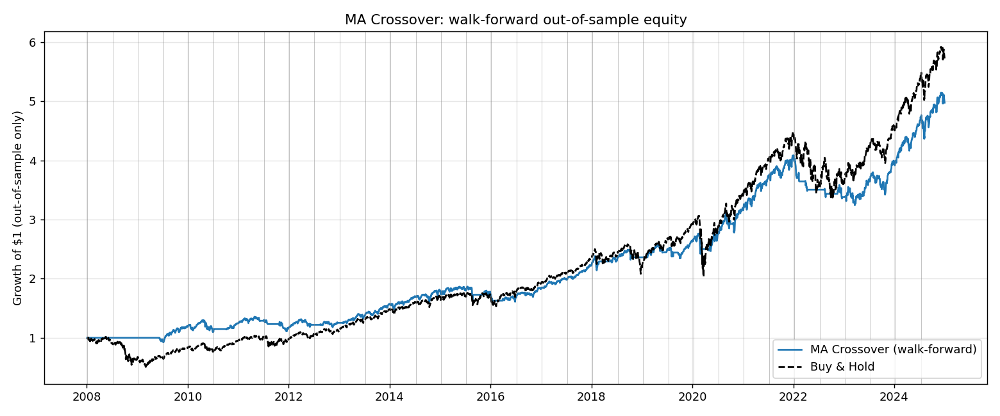

# Algorithmic Trading Backtester

[](https://github.com/dhruv-deepak/Backtester/actions/workflows/tests.yml)

A from-scratch daily backtesting engine that is built to tell you **whether to
believe its own results**.

Most backtests lie in one of three ways: they use information the strategy
couldn't have had (lookahead), they assume fills and costs that don't exist,
or they report the best of many attempts as if it were the only one
(selection bias). This project attacks all three:

| Failure mode | What this project does about it |
|---|---|
| **Lookahead bias** | Every strategy is **automatically audited** before it runs: its signal is recomputed on truncated histories and must not change. Canary tests prove the audit catches `shift(-1)`, full-sample normalisation and centered windows. |
| **Unrealistic execution** | Decisions made at the close fill at the **next open**, so the overnight gap is not free money. Costs include commission, spread, volatility-scaled slippage, short-borrow fees and leverage financing. |
| **Luck and selection bias** | Every Sharpe ratio comes with a **block-bootstrap confidence interval**, the **Probabilistic Sharpe Ratio**, and the **Deflated Sharpe Ratio**, which raises the bar based on how many variants you tried. Parameters are chosen by **walk-forward optimisation**, never on the data they're scored on. |

## Results on 20 years of SPY (2005–2024)

All numbers are net of costs with next-open fills.

```
                  Sharpe  95% CI         PSR    DSR    Max DD   CAGR
Buy & Hold         0.61   [ 0.22, 1.06]  1.00   0.94   -55.2%   10.3%
MA Crossover       0.58   [ 0.15, 1.05]  0.99   0.91   -27.0%    6.4%
Momentum           0.19   [-0.18, 0.57]  0.80   0.37   -44.9%    1.8%
Mean Reversion     0.18   [-0.17, 0.58]  0.79   0.36   -36.4%    1.6%
Donchian Breakout  0.01   [-0.37, 0.36]  0.52   0.13   -44.1%   -1.1%
ML (logreg)        0.06   [-0.31, 0.48]  0.61   0.18   -60.4%   -0.4%
```

What this says:

- **Only buy-and-hold and the MA crossover have Sharpe CIs that exclude zero.**
  The other three rule-based strategies can't be told apart from no edge.
- **The ML classifier has no skill.** Its out-of-sample accuracy is 53.9%, but
  the up-day base rate is 54.9%: binomial p = 0.91, AUC = 0.49. Its P&L is noise.
- **Walk-forward MA crossover** re-optimises its parameters every 6 months on
  the prior 3 years only. Out of sample it earned **Sharpe 0.86 vs 0.61** for
  buy & hold, with a **-21% max drawdown vs -52%**. Across the 24 parameter
  combos, 100% had a positive Sharpe (a broad plateau, not a lucky spike) and
  the best one survives deflation (DSR 0.997).
- **But look at the chart.** Almost all of that edge comes from sidestepping
  2008. After that, the strategy trails buy & hold. A single regime doing all
  the work is precisely what the summary statistics hide.



## Proving the tools work: null and positive controls

A test that always says "no edge" is as useless as one that always says "edge".
The synthetic data generator gives both controls:

- `--trend 0` is a pure random walk. **Nothing is predictable by construction**,
  so any edge a strategy shows is noise. Every strategy's CI includes zero, and
  the ML gets p = 0.73. (The original version of this project reported a "+1.29pp
  edge" for its classifier on a random walk, with no way to tell it was noise.)
- `--trend 0.1` plants a slowly-wandering hidden drift. Momentum (Sharpe 1.12)
  and breakout (1.02) **correctly** come out significant, and mean reversion
  **correctly** comes out significantly *negative*, because fading a trend loses.

The test suite checks that PSR is calibrated: under the null it exceeds 0.95
about 5% of the time. It also checks that DSR rejects the best of 200
noise strategies when plain PSR is fooled by it.

## Usage

```bash
pip install -r requirements.txt
```

```bash
python main.py compare
```

```bash
python main.py compare --ticker SPY --start 2005-01-01 --end 2025-01-01 --ml
```

```bash
python main.py optimize --strategy ma --ticker SPY --start 2005-01-01 --end 2025-01-01
```

```bash
python -m pytest
```

Useful options (`python main.py compare -h` lists them all):

| Option | Meaning |
|---|---|
| `--trend 0.1` | synthetic data with a planted edge (default `0` = random walk) |
| `--csv prices.csv` | load your own OHLCV data |
| `--execution close` | optimistic same-close fills, to see how much a result depends on them |
| `--vol_target 0.15` | size positions to 15% annualised volatility (with a rebalance band) |
| `--ml --model rf` | add the walk-forward ML classifier (`logreg`, `rf` or `gbm`) |
| `--commission_bps`, `--spread_bps`, `--vol_slippage`, `--borrow_bps` | cost model |
| `--strategy {ma,momentum,meanrev,breakout}` | which strategy to `optimize` |
| `--train_days`, `--test_days`, `--anchored` | walk-forward windows |

Charts are written to `output/` (equity/drawdown/rolling-Sharpe tearsheet,
parameter heatmap, walk-forward equity). Yahoo downloads are cached in
`data_cache/`.

## How it works

### Execution and costs (`engine.py`)
A signal computed from day *t*'s close becomes a position at day *t+1*'s
open. On that day the old position earns the overnight gap and the new one
earns the open-to-close move. The original version of this project filled at
the same close it used to decide, which is impossible in live trading. The
`Sharpe @close fill` column shows how much each strategy depended on that.

Per unit of position traded, you pay commission, half the spread, and slippage
proportional to recent volatility. Per day, you pay borrow fees on shorts and
financing on leverage above 1x. Round trips are extracted into a trade log, so
win rate and profit factor are measured **per trade**, not per day.

### Statistics (`stats.py`)
- **PSR** (Bailey & López de Prado, 2012): the probability that the true Sharpe
  is above zero, given the sample length, skewness and fat tails.
- **DSR** (Bailey & López de Prado, 2014): PSR measured against the Sharpe the
  *best of N worthless strategies* would show by luck. Try 24 parameter combos
  and the bar rises to match.
- **Circular block bootstrap** CIs. Resampling blocks rather than single days
  preserves volatility clustering.

### Lookahead audit (`validation.py`)
A causal signal at row *t* must be identical whether it is computed on the full
history or on data cut off at *t*. `check_no_lookahead()` tests this at several
cut points and runs automatically before every `compare`. Use it on any new
strategy you write.

### Walk-forward optimisation (`optimize.py`)
For each window: pick the parameters with the best Sharpe on the prior
`train_days`, then trade them on the next `test_days`. The test windows are
stitched together and run through the engine once, so the cost of switching
parameters is charged. **Walk-forward efficiency** (OOS Sharpe / in-sample
Sharpe) measures how much of the in-sample performance survives.

### ML strategy (`ml.py`, `features.py`)
Price/volume features (multi-horizon returns, MA distance, volatility regime,
RSI, candle structure, overnight gap, volume). The model is retrained every 21
days on an expanding (or `train_window` rolling) window of past rows whose
labels were already known at that time. The final bar, whose outcome isn't known
yet, is still predicted, because that's the one you'd trade. Skill is judged by
a binomial test against the majority-class baseline and by AUC, not by P&L.
A regularised logistic regression is the default; the random forest and
gradient boosting have to beat it to justify their complexity.

## Project structure

```
backtester/
├── data.py         # Yahoo (cached) / CSV / synthetic null & positive-control data
├── strategies.py   # MA crossover, momentum, mean reversion, Donchian breakout, vol targeting
├── engine.py       # fills, cost model, trade log
├── metrics.py      # CAGR, Sharpe, Sortino, drawdown, trade stats
├── stats.py        # PSR, DSR, block bootstrap
├── validation.py   # automated lookahead audit
├── optimize.py     # grid search, walk-forward optimisation
├── features.py     # ML features
├── ml.py           # walk-forward classifier + skill tests
├── report.py       # tables and charts
└── cli.py          # `compare` and `optimize` commands
tests/              # 35 tests: engine arithmetic, metrics, statistics, lookahead canaries
main.py             # entry point
```

## Limitations and next steps

- Single asset, daily bars. Natural extension: a multi-asset portfolio with a
  weights matrix and correlation-aware sizing.
- The cost model is a parametric approximation. It has no order-book data and
  no market impact that scales with trade size.
- Yahoo data is survivorship-biased at the universe level: you only think to
  test tickers that still exist.
- DSR across *different* strategies (as in `compare`) treats them as trials of
  one search. That's the conservative reading, but the trials aren't independent.
